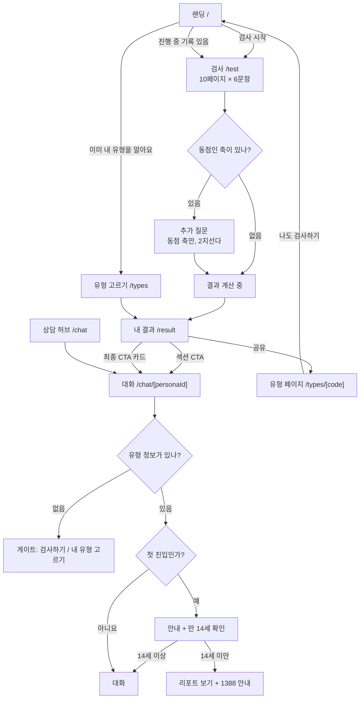

# 유저 플로우 설계 (user_flow_spec)

> 버전: v1.0 확정 · 작성일: 2026-10-29 (사용자 검토 완료)
> 근거 문서: `MBTI_AI상담_서비스_기획기반문서.md`(2장 서비스 구조, 8장 안전·윤리, 10장 단기 ④), `docs/plan/overview.md`
> 연결 문서: `docs/plan/report_spec.md`(리포트) · `docs/plan/chatbot_spec.md`(상담) · `docs/plan/copy_tone_guide.md`(문구)
> 범위: 검사 → 리포트 → 상담까지의 화면 흐름, 채점 규칙, 저장·개인정보. **화면 디자인과 구현은 범위 밖이다**(단기 ③, 앱 단계).

---

## 0. 결정 기록

| 날짜 | 결정 | 이유 |
|---|---|---|
| 2026-10-29 | 축 합계가 0(동점)이면 **그 축만 2지선다 추가 질문 1개**로 정한다 (§6.2) | 성향이 중간쯤인 사람은 네 축 중 하나 이상이 동점일 확률이 19~28%로 계산됨. 숨은 규칙 대신 사용자가 직접 고르게 함 |
| 2026-10-29 | 검사 화면은 **한 화면에 6문항**, 10페이지 (§5) | 16P식. 앞뒤 문항을 함께 보며 답할 수 있음 |
| 2026-10-29 | 상담 첫 진입 때 **1회 안내 + 만 14세 확인**. 14세 미만이면 상담 대신 리포트와 1388을 안내한다 (§9) | 대화가 외부 AI 제공자로 전달됨. 국내법상 만 14세 미만의 개인정보 처리에는 보호자 동의가 필요함 |
| 2026-10-29 | 검사 없이 **유형 직접 선택을 허용**한다. 성향 스펙트럼은 검사한 사람에게만 보여 준다 (§7.2) | 이미 유형을 아는 사용자의 이탈을 줄임 |
| 2026-10-29 | 화면을 만들 때 **Claude 데스크탑으로 함께 조정하는 단계**를 둔다 (§14) | 사용자 요청. 화면은 텍스트가 아니라 눈으로 보며 고쳐야 함 |
| 2026-10-29 | §16 검토 포인트 10개를 **기본값 그대로 확정** | 사용자 검토 결과 "큰 문제 없음" |

---

## 1. 목적

- 세 레이어(① 검사 ② 리포트 ③ AI 상담)를 **끊기지 않는 하나의 흐름**으로 잇는다.
- 앞 단계에서 미뤄 둔 결정을 여기서 정한다.
  - report_spec §8: 축 합계가 0일 때 판정 규칙
  - chatbot_spec §11: 위기 안내 카드 위치, 면책 고정 위치, 페르소나 선택 진입점
- 이 문서의 규칙은 데이터(`questions.json`·`scoring.json` 등)와 순수 모듈(`lib/assessment/`)로 옮겨, 화면 구현 때 그대로 쓴다(§13).

---

## 2. 전체 흐름



---

## 3. 화면·라우트 (Next.js App Router 제안)

| 경로 | 화면 | 비고 |
|---|---|---|
| `/` | 랜딩 | 진행 중 검사·저장된 결과에 따라 버튼이 바뀜 |
| `/test` | 검사 + 동점 추가 질문 + 계산 중 | 한 경로 안에서 단계 전환. 새로고침해도 기기 저장으로 이어짐 |
| `/result` | 내 결과 리포트 | 기기에 저장된 결과로 렌더. 없으면 랜딩으로 |
| `/types` | 16유형 목록 | 직접 선택 + 둘러보기 |
| `/types/[code]` | 유형 리포트(공개) | 공유 링크의 목적지. 성향 스펙트럼 없음 |
| `/chat` | 상담 허브 | 세 상담사 카드 |
| `/chat/[personaId]` | 대화 | `career` · `relationship` · `growth` |
| `/privacy` | 개인정보 안내 | 출시 전 법률 검토 필요 (§15) |

- `/result`와 `/types/[code]`는 같은 리포트 컴포넌트를 쓰고, **성향 스펙트럼 섹션과 상단 배너만 다르다**.
- 상단 공통 메뉴는 화면 단계에서 정한다. 최소한 '내 결과'와 '상담'에 어디서든 갈 수 있어야 한다.

---

## 4. 랜딩 (`/`)

- 한 줄 소개, 버튼 2개
  - [검사 시작하기] — 보조 문구 "60문항 · 약 10분"
  - [이미 내 유형을 알아요] → `/types`
- 상태별 추가 요소
  - 검사 진행 중 기록이 있으면: "지난번에 {n}문항까지 답했어요" 배너 + [이어서 하기] [처음부터]
  - 저장된 결과가 있으면: [내 결과 다시 보기]
- 푸터: 면책 한 줄(리포트와 같은 문구), 개인정보 안내 링크

---

## 5. 검사 (`/test`)

### 5.1 화면 구성
- 시작 안내: `questions.json`의 `instructions.text_ko` + "정답은 없어요. 떠오르는 대로 고르면 돼요."(문구는 `flow-copy.json`)
- **한 페이지에 6문항, 총 10페이지**
- 7점 척도
  - 양끝 라벨만 보여 준다: "동의하지 않아요" ↔ "동의해요". 가운데는 중립.
  - 원 크기로 강도를 나타낸다(양끝이 크고 가운데가 작음).
  - 접근성: 각 선택지에 `questions.json`의 7단계 라벨을 스크린리더용으로 붙인다.
- 응답하면 **다음 미응답 문항으로 자동 스크롤**한다.
- [다음]은 그 페이지 6문항을 모두 답해야 활성화된다. [이전]으로 언제든 돌아가 답을 바꿀 수 있다.
- 진행 표시: 상단 막대(답한 문항 수 / 60) + "3 / 10"
- 마지막 페이지의 버튼은 [결과 보기]

### 5.2 문항 순서 — 고정 교차 순서
- 원본은 축 순서대로 나열돼 있다(E/I 15개 → S/N → T/F → J/P). 그대로 내면 한 페이지가 한 축으로만 채워진다.
- **규칙**: 축을 EI → SN → TF → JP 순서로 돌아가며, 각 축에서 id 순서대로 한 문항씩 뽑는다.
  - 순서: q001, q016, q031, q046, q002, q017, q032, q047, …
  - 결과: 어느 페이지에나 4축이 모두 들어가고(2·2·1·1), 같은 축 문항이 연달아 나오지 않는다.
- **무작위가 아니라 고정**한다. 이어서 하기가 안전하고, 모든 사용자가 같은 검사를 받는다.
- 순서는 `questions.json`의 `presentation.order`에 id 배열로 명시한다(§13).

### 5.3 저장·이어 하기
- 응답할 때마다 기기(localStorage)에 즉시 저장한다(§11).
- 중간에 나갔다가 돌아오면 랜딩이나 `/test`에서 [이어서 하기] [처음부터]를 고른다.
- 저장된 진행 기록의 문항 버전이 현재 `questions.json` 버전과 다르면 기록을 버리고 "검사가 조금 바뀌어서 처음부터 시작해요"를 안내한다.

---

## 6. 채점 규칙

### 6.1 기본 (기존 `scoring.json` 유지)
1. 각 응답에서 4를 빼서 중심화한다(-3 ~ +3).
2. 역채점 문항은 부호를 바꾼다.
3. 축별로 15문항을 합산한다(-45 ~ +45).
4. 합이 양수면 첫 번째 극(E·S·T·J), 음수면 두 번째 극(I·N·F·P).
5. 강도(%) = |합계| ÷ 45 × 100, 반올림

### 6.2 동점 — 2지선다 추가 질문
- **언제**: 어느 축의 합계가 정확히 0일 때. 그 축에만 묻는다(최대 4문항).
- **어디서**: 마지막 페이지에서 [결과 보기]를 누른 직후. "거의 다 왔어요! 하나만 더 골라 주세요"
- **형식**: 장면 하나 + 선택지 2개. 중립 선택지는 없다. 선택지 순서는 고정한다.
- **판정**: 고른 극으로 정한다. 합계 0, 강도 0은 그대로 두고 `tieBroken: true`로 표시한다.
- **문항**: 축당 1개, 총 4개. `mbti-psychologist` 에이전트가 쓴다.
  - 기준: 두 선택지가 똑같이 괜찮아 보일 것(우열 없음), 일상 장면, 10대도 답할 수 있는 상황, 기존 문항과 같은 평서형 문체
  - 기존 60문항과 내용이 겹치지 않을 것
- **확정 문항** (`questions.json` `tieBreakers`, 2026-10-29 `mbti-psychologist` 작성)

  | 축 | 장면 | 첫 번째 극 | 두 번째 극 |
  |---|---|---|---|
  | EI | 오래 준비한 일을 드디어 끝낸 날 | E: 사람들을 만나 이야기하며 기운을 채운다. | I: 혼자 조용히 시간을 보내며 기운을 채운다. |
  | SN | 재미있게 본 영화를 친구에게 이야기할 때 | S: 기억에 남는 장면과 대사를 생생하게 말한다. | N: 영화를 보고 떠오른 생각과 상상을 말한다. |
  | TF | 둘 다 괜찮아서 하나를 고르기 어려울 때 | T: 조건과 근거를 따져 납득되는 쪽을 고른다. | F: 사람과 가치를 생각해 마음 가는 쪽을 고른다. |
  | JP | 친구와 만날 약속을 잡을 때 | J: 만나서 할 일을 미리 정해 둔다. | P: 만나서 할 일은 그때 가서 정한다. |

  - 문항 하나로 정하는 방식이라 신뢰도에 한계가 있다. 그래서 결과 화면에 "추가 질문으로 정했어요"와 경계 문구를 반드시 함께 보여 준다(§6.3).

### 6.3 경계 표시
- 강도가 **10% 미만**(합계 -4 ~ +4)인 축은 스펙트럼에 문구를 붙인다.
  - "두 성향이 비슷하게 섞여 있어요. 상황에 따라 양쪽 모습이 모두 나올 수 있어요."
- 동점으로 정한 축(강도 0)에는 "추가 질문으로 정했어요"도 함께 보여 준다.
- 표시 비율은 기존 규칙(report-sections `axes.displayRule`)을 따른다: 우세 쪽 = 50 + 강도 ÷ 2. 강도 0이면 50 : 50으로 보이고 고른 쪽 라벨이 강조된다.

### 6.4 결과 객체

```jsonc
{
  "typeCode": "INFP",
  "source": "test",                 // "test" | "self"(직접 선택)
  "scoringVersion": "1.1.0",
  "axes": {                         // source 가 "test" 일 때만
    "EI": { "pole": "I", "score": -12, "percentage": 27, "borderline": false, "tieBroken": false },
    "SN": { "pole": "N", "score": 0,   "percentage": 0,  "borderline": true,  "tieBroken": true }
    // TF, JP
  },
  "completedAt": "2026-10-29T10:00:00+09:00"
}
```

---

## 7. 결과 리포트

### 7.1 진입
- [결과 보기] → 1~2초 "결과를 정리하고 있어요" 화면 → `/result`
  - 실제 계산은 즉시 끝난다. 이 화면은 기대감을 위한 연출이며 2초를 넘기지 않는다.
- 섹션 순서·제목·CTA는 `report-sections.json`을 따른다(report_spec §2).
- 리포트 맨 아래: [다시 검사하기] — 기존 결과를 덮어쓴다는 확인을 한 번 받는다.

### 7.2 유형 직접 선택
- `/types`에서 유형을 고르면 `source: "self"`로 결과를 저장하고 `/result`로 간다.
- 성향 스펙트럼 섹션 자리에 대체 카드를 둔다: "검사로 내 성향 스펙트럼을 확인해 볼까요?" + [검사하기]
- 검사 결과가 이미 있는데 직접 선택하면 "검사 결과 대신 이 유형으로 볼까요?"를 확인한다.
- 상담은 직접 선택한 유형으로도 이용할 수 있다.

### 7.3 공유
- 위치: 거울 섹션(한눈에 보는 나) 바로 아래 + 리포트 끝
- 동작: Web Share API로 `/types/[code]` 링크를 공유한다. 지원하지 않으면 링크를 복사하고 "링크를 복사했어요"를 띄운다.
- **개인 수치(축 %)는 공유 링크에 넣지 않는다.** 받은 사람은 유형 리포트만 본다.
- 9:16 공유 카드 이미지는 중기 과제다. 버튼 자리는 같은 곳에 둔다.

### 7.4 유형 페이지 (`/types/[code]`)
- 공유 링크로 들어온 사람과 둘러보기 사용자를 위한 공개 리포트
- 상단 배너: "이 유형이 궁금했나요? 나도 검사해 보기" → 랜딩
- 상담 CTA는 그대로 보이지만, 누르면 §8의 유형 게이트를 거친다(자기 유형이 아닐 수 있으므로).

---

## 8. 상담 진입점

| 경로 | 위치 | 동작 |
|---|---|---|
| ① 섹션 CTA | 직업·연애관·궁합 미리보기·사회생활 팁·성장 한마디 섹션 끝 | 해당 상담사 대화로 이동. `starterIndex` 질문을 **입력창에 채워 둔다**(자동 전송 안 함) |
| ② 최종 CTA | 리포트 끝 카드 3장 | 해당 상담사 대화로 이동. 입력창은 비워 둔다 |
| ③ 상담 허브 | `/chat` | 세 상담사 카드(이름·라벨·담당 범위 한 줄) |
| ④ 페르소나 전환 | 대화 헤더 | 다른 상담사로 바로 이동 |

- **궁합 미리보기 카드**를 탭하면 하랑 대화로 가고, 그 카드의 유형이 상대 유형으로 미리 설정된다(§10.8).
- **유형 게이트**: 기기에 결과가 없으면 대화 대신 게이트 화면을 띄운다.
  - "상담사가 맞춤 조언을 하려면 성격 유형이 필요해요"
  - [검사하기] [내 유형 고르기] — 고른 뒤에는 원래 가려던 대화로 돌아온다.

---

## 9. 상담 첫 진입 안내 (기기당 1회)

- **안내 내용**(문구는 `flow-copy.json`)
  1. 상담사는 AI예요. 답변을 만들기 위해 대화 내용이 외부 AI 서비스로 전달돼요.
  2. 이름·연락처·주소·학교처럼 나를 알아볼 수 있는 정보는 적지 말아 주세요.
  3. 대화는 이 기기에만 저장되고, 서비스 서버에는 남지 않아요.
  4. 전문 심리 상담이나 진단을 대신하지 않아요.
- **버튼**: [만 14세 이상이에요] [만 14세 미만이에요]
- **14세 미만 화면**
  - "지금은 만 14세 이상만 AI 상담을 이용할 수 있어요. 리포트는 그대로 볼 수 있어요."
  - [내 리포트 보기]
  - 고민이 있을 때: 청소년상담 1388 — 전화 1388, 문자 1388, 카카오톡 '청소년상담1388' (24시간)
- 선택은 기기에 기억한다(§11). 14세 미만을 고른 기기는 상담 진입 때마다 같은 화면을 보여 준다.

---

## 10. 대화 화면 (`/chat/[personaId]`)

### 10.1 레이아웃
```
┌─────────────────────────────┐
│ ← 하랑 · 관계 상담사  [전환] [도움받을 곳] │  헤더 (고정)
│ 참고용이며 전문 상담·진단을 대신하지 않아요   │  면책 한 줄 (고정)
├─────────────────────────────┤
│ (대화 영역)                     │
│  하랑: 인사말 …                 │
│  [추천 질문 칩 ×4]              │
│  [상대 유형 알려주기] (하랑만)  │
│  …                              │
│  하랑: 답변                     │
│  ┌ 위기 안내 카드 (감지 시) ┐  │
│  └──────────────────┘  │
├─────────────────────────────┤
│ [입력창                 ] [보내기] │  하단 (고정)
└─────────────────────────────┘
```

### 10.2 빈 대화
- 페르소나별 **정적 인사말**(2문장, 캐릭터 말투)을 첫 말풍선으로 보여 준다. API를 호출하지 않으며, 모델에 보내는 대화 이력에도 넣지 않는다.
- 추천 질문 칩 4개(`starterQuestions`). 탭하면 입력창에 채워진다.

### 10.3 위기 안내 카드
- **언제**: 응답의 `result.safety.crisis`가 `true`일 때. 모델 답변 내용과 **상관없이 항상** 띄운다.
- **어디**: 그 답변 말풍선 **바로 아래 인라인**. 같은 대화에서 다시 감지되면 다시 띄운다.
- **내용**: 고정 문구 한 줄 + 상담 자원 목록(chatbot_spec §7.3). 각 자원은 탭하면 바로 연결된다.
  - 109 → `tel:109`, 1577-0199 → `tel:15770199`, 1388 → `tel:1388`·`sms:1388`, 1366 → `tel:1366`, 112·119 → 각 `tel:`
  - 카카오톡 '청소년상담1388'은 링크 없이 이름만 안내한다.
- **헤더 [도움받을 곳]**: 위기 감지와 무관하게 **항상 보이는 버튼**. 누르면 같은 자원 목록을 바텀시트로 띄운다. 키워드 감지를 피해 간 표현이나 대화 밖 상황에도 스스로 찾아갈 수 있게 한다.
- 자원을 링크로 만들려면 `crisisProtocol.resources`에 연결 정보(`actions`)가 따로 필요하다(§13).

### 10.4 면책 표시
| 화면 | 위치 | 문구 출처 |
|---|---|---|
| 대화 | 헤더 바로 아래 한 줄 고정 | `chatbot-prompts.json` `shared.disclaimer` (해요체로 통일, §13) |
| 리포트 | 최종 CTA 아래 (report_spec §3.12) | `report-sections.json` `notices.disclaimer` |
| 랜딩·검사 | 푸터 한 줄 | 리포트와 같은 문구 |

- 모델 답변에는 면책을 반복하지 않는다(chatbot_spec §4, 이미 프롬프트에 반영).

### 10.5 오류·한도

| 상황 | 화면 |
|---|---|
| 모든 AI 제공자 실패 (위기 아님) | 보낸 메시지를 지우지 않고 "지금 상담사와 연결이 잘 안 돼요. 잠시 후 다시 보내 주세요" + [다시 보내기] |
| 모든 AI 제공자 실패 (위기) | `getAdvice()`가 고정 안내 문구와 자원을 돌려준다(이미 구현). 위기 카드도 함께 띄운다 |
| 메시지 길이 초과 | 입력창 아래 "{max}자까지 보낼 수 있어요", 보내기 비활성 |
| 하루 사용 한도 초과 | "오늘은 이야기를 많이 나눴어요. 내일 다시 만나요" + [도움받을 곳]은 그대로 |

- **잠정 한도**: 메시지 500자, 기기당 하루 30회. 수치와 서버 쪽 집행 방법(저장소)은 앱 단계에서 정한다(§15).
- 위기 키워드가 들어간 메시지는 한도를 넘었어도 안내를 막지 않는다. 한도 초과 화면에서도 위기 감지는 클라이언트에서 다시 돌려 카드를 띄운다(`detectCrisis`는 순수 함수라 브라우저에서도 쓸 수 있음).

### 10.6 대화 저장·전송
- 대화는 **페르소나별 스레드로 기기에만** 저장한다. [대화 지우기]로 언제든 삭제한다.
- 서버로는 **최근 메시지 12개(6번 주고받기)**만 이력으로 보낸다(잠정).
  - 이유: 시스템 프롬프트가 이미 5,700~6,600자다. 무료 제공자의 분당 토큰 한도(예: Groq)를 넘기지 않으려면 이력을 짧게 유지해야 한다. 앱 단계에서 실제 토큰 수로 다시 정한다.
- 서버(Route Handler)는 요청을 AI 제공자에게 전달만 하고 대화를 저장하지 않는다.

### 10.7 페르소나 전환
- 헤더의 [전환]으로 세 상담사 중 하나를 고른다.
- 바꾸면 그 상담사의 스레드로 이동한다. **이전 상담사와의 대화는 넘기지 않는다.**
- 모델이 "이 고민은 지온이 더 잘 도와줄 수 있어요"처럼 안내하면(chatbot_spec §2 경계 규칙), 사용자가 헤더 전환으로 이동한다. 답변 내용을 해석해 자동으로 버튼을 만들지는 않는다.

### 10.8 하랑 — 상대 유형
- 하랑 대화에만 [상대 유형 알려주기] 칩을 둔다 → 16유형 선택 시트 → `partnerTypeCode`
- 설정하면 입력창 위에 "상대: ENFJ ✕" 표시. 이후 모든 메시지에 함께 보낸다.
- 궁합 미리보기 카드에서 들어오면 미리 설정되어 있다.

---

## 11. 저장·개인정보

### 11.1 기기 저장 (localStorage)

| 키 | 내용 | 지우는 때 |
|---|---|---|
| `ptype.progress` | `{ v, questionsVersion, answers: {q001: 5, …}, tieBreaks: {EI: "E"}, page, updatedAt }` | 결과 저장 직후, [처음부터] |
| `ptype.result` | §6.4 결과 객체 | [다시 검사하기]로 덮어씀 |
| `ptype.chat.career` / `.relationship` / `.growth` | `{ v, messages: [{role, content, crisis?, at}], partnerTypeCode? }` | [대화 지우기] |
| `ptype.chatConsent` | `{ v, ageGroup: "14plus" \| "under14", at }` | 사이트 데이터 삭제 |

- 키 접두사에는 상표명을 쓰지 않는다.
- 모든 값에 버전(`v`)을 둬서 구조가 바뀌면 안전하게 버리거나 옮긴다.

### 11.2 원칙
- **서버에 검사 결과와 대화를 보관하지 않는다.** 로그인이 없고 DB도 없다.
- 상담 요청 때만 유형 코드·대화 이력·메시지가 서버를 거쳐 AI 제공자로 전달된다.
- 무료 AI 제공자 중 일부는 입력을 서비스 개선에 쓸 수 있다. 그래서 §9 안내에서 개인정보를 적지 말라고 미리 알린다.
- 분석 이벤트에는 대화 내용·응답 값을 넣지 않는다(§12).
- `/privacy`에 위 내용을 쉬운 말로 적는다. 출시 전 법률 검토를 받는다(§15).

---

## 12. 분석 이벤트

내용 없이 **이벤트 이름과 최소 속성만** 남긴다.

| 이벤트 | 속성 | 보는 것 |
|---|---|---|
| `test_start` | — | 유입 |
| `test_page_reached` | `page` | 페이지별 이탈 |
| `tiebreak_shown` | `axes` 개수 | 동점 빈도 (§0 추정치 검증) |
| `test_complete` | `typeCode` | 완료율, 유형 분포 |
| `type_self_selected` | `typeCode` | 직접 선택 비율 |
| `report_section_view` | `sectionId` | 어디까지 읽는지 |
| `share_click` | `method`(share·copy) | 공유율 |
| `chat_cta_click` | `personaId`, `sectionId` | 어느 섹션이 상담으로 잇는지 |
| `chat_consent` | `ageGroup` | 14세 미만 비율 |
| `chat_message_sent` | `personaId` | 상담 사용량 |
| `crisis_card_shown` | — (개수만) | 안전망 동작 빈도 |
| `chat_error` | `kind`(provider·limit) | 무료 제공자 안정성 |

---

## 13. 데이터·코드 반영 목록 (2026-10-29 반영 완료)

| 대상 | 변경 |
|---|---|
| `data/questions.json` → v1.1.0 | `presentation: { perPage: 6, order: [60개 id] }` 추가. `tieBreakers` 4개 추가(`{ id, axis, text_ko, options: [{ pole, text_ko }, { pole, text_ko }] }`, `mbti-psychologist` 작성) |
| `data/scoring.json` → v1.1.0 | `tieBreak`(forced-choice, 합계 0일 때, 출처 `questions.tieBreakers`), `borderline: { maxPercentage: 10 }`, `calculation.steps_ko` 6단계 추가 |
| `data/report-sections.json` → v1.1.0 | `axes.borderlineNote`, `axes.tieBrokenNote`, `selfSelectedAxesCard` 추가 |
| `data/chatbot-prompts.json` → v2.2.0 | 페르소나별 `greeting` 추가. `shared.disclaimer` 해요체 통일. `crisisProtocol.resources[*].actions`(`tel`·`sms` 연결 정보) 추가 |
| `data/flow-copy.json` (신규) | 리포트 밖 화면 문구: 랜딩, 검사 안내·이어 하기, 동점 질문 안내, 계산 중, 유형 게이트, 첫 진입 안내·14세 미만 화면, 오류·한도, [도움받을 곳] |
| `lib/assessment/` (신규) | 순수 TS. `order.ts`(`buildPages`·`isPageComplete`·`countAnswered`), `scoring.ts`(`scoreAxes`·`findTies`·`tieBreakersFor`·`resolveResult`·`selfSelectedResult`·`toDisplayRatio`), `types.ts`, `index.ts` |
| `lib/chatbot/` | `types.ts`에 `greeting?`·`actions?` 선택 필드. `listPersonas()`가 `greeting`·`scope`도 반환. 프롬프트 조립은 그대로 |
| 문서 | overview §3 문서 목록, report_spec §3.2·§8, chatbot_spec §11, README |

---

## 14. 다음 단계

- **③ 디자인 무드보드·세계관·마스코트**: 이 문서의 화면 목록(§3)과 레이아웃 스케치(§10.1)를 시안의 범위로 쓴다.
- **화면 구현 — Claude 데스크탑 협업 단계**
  1. 화면별 시안(HTML)을 Artifact로 올린다.
  2. 사용자가 Claude 데스크탑에서 시안을 보며 함께 조정한다(배치·문구·색·크기).
  3. 합의한 시안을 Next.js 컴포넌트로 옮긴다.
  4. 실제 앱 화면을 다시 데스크탑에서 확인한다.
  - 한 번에 모든 화면을 하지 않고, 랜딩 → 검사 → 리포트 → 상담 순서로 한 화면씩 진행한다.

---

## 15. 미결

| 항목 | 담당 단계 |
|---|---|
| 개인정보·만 14세 기준 법률 검토, `/privacy` 본문 | 출시 전 |
| 서버 쪽 사용 한도 집행 방법(저장소)과 최종 수치 | 앱 단계 (챗봇 API) |
| 대화 이력 길이(메시지 12개)의 실제 토큰 검증 | 앱 단계 (챗봇 API) |
| 9:16 공유 카드 이미지 | 중기 |
| A/T(안정형/민감형) | 검사 확장 (미정) |
| 상단 공통 메뉴 구성 | 단기 ③ 디자인 / 화면 구현 |

---

## 16. 검토 포인트 (2026-10-29 확정)

아래 기본값을 모두 그대로 확정했다.

| # | 항목 | 기본값 | 위치 |
|---|---|---|---|
| 1 | 라우트 구성 | 8개 경로, `/result`와 `/types/[code]`는 같은 리포트 컴포넌트 | §3 |
| 2 | 공유 링크 | 유형 페이지 링크(개인 축 % 제외) | §7.3 |
| 3 | CTA로 상담에 들어갈 때 | 추천 질문을 입력창에 채워 둠(자동 전송 안 함) | §8 |
| 4 | 위기 카드 | 해당 답변 바로 아래 인라인 + 헤더 [도움받을 곳] 상시 버튼 | §10.3 |
| 5 | 면책 위치 | 대화: 헤더 아래 한 줄 고정 / 리포트: 최종 CTA 아래 / 랜딩·검사: 푸터 | §10.4 |
| 6 | 저장 | 기기에만 저장, 서버 보관 없음 | §11 |
| 7 | 경계 표시 기준 | 강도 10% 미만 | §6.3 |
| 8 | 상담 한도(잠정) | 메시지 500자, 하루 30회, 이력 메시지 12개 | §10.5·§10.6 |
| 9 | 문항 순서 | 고정 교차 순서(무작위 아님) | §5.2 |
| 10 | 14세 미만 기기 | 상담 진입 때마다 같은 안내(다시 고를 수 없음, 사이트 데이터 삭제 시 초기화) | §9 |
